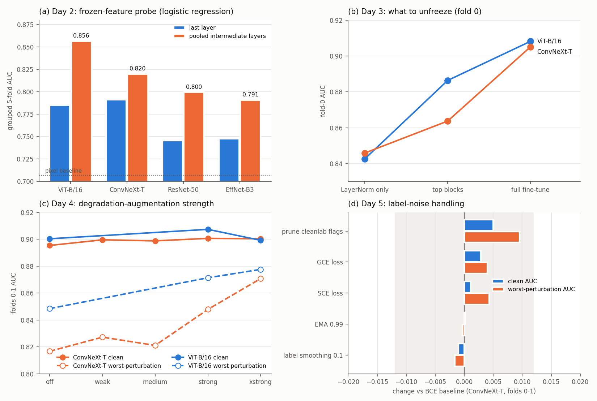
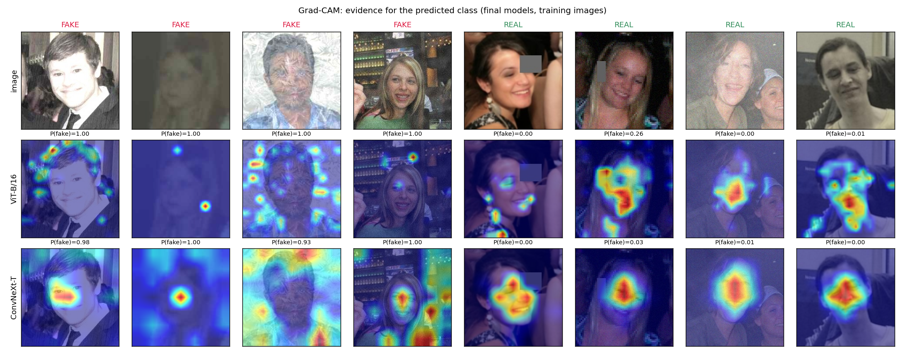

# Deepfake Image Detection

**Noise-aware ViT-B/16 + ConvNeXt-T ensemble for real-vs-fake face classification**
*IIIT Bangalore Deepfake ML Hackathon*


| Metric | Value |
|---|---|
| Grouped 5-fold out-of-fold ROC-AUC | **0.909** (95% cluster CI 0.902–0.917) |
| Mean AUC over 11 image perturbations | **0.905** (worst case 0.886, pixelation) |
| Accuracy / F1 at threshold 0.5 | 0.874 / 0.874 |
| Inference time, 3,000 images (6 models + flip TTA) | ~3 min on an RTX 4060 Laptop GPU |
| Model size | 682 MB (limit 5 GB) |

The full write-up is in the [technical report (PDF)](reports/Technical_Report.pdf).

---

## Contents

- [Quick start](#quick-start)
- [Approach](#approach)
- [Results](#results)
- [Repository structure](#repository-structure)
- [Reproducing training](#reproducing-training)
- [Rules compliance](#rules-compliance)
- [Limitations](#limitations)

---

## Quick start

### 1. Install

```bash
python -m venv .venv
# Windows: .venv\Scripts\activate   |   Linux/macOS: source .venv/bin/activate
pip install torch==2.7.1 torchvision==0.22.1 --index-url https://download.pytorch.org/whl/cu126
pip install -r requirements.txt
```

### 2. Download the weights

`model_weights.pt` (682 MB) is too large for GitHub. Download it from Google Drive and place it in the repository root:

**[Download model_weights.pt from Google Drive](https://drive.google.com/drive/folders/1zd-Q4IY6rwPWusZlws28ZG90LeZhjJuE?usp=sharing)**

This single file contains all six models (fp16 state dicts) and the ensemble configuration. No other downloads are
needed: models are built with `pretrained=False`, so inference runs offline.

### 3. Run inference

```bash
python inference_script.py --test_dir ./test/images/ --weights ./model_weights.pt --output predictions.csv
```

| Argument | Default | Description |
|---|---|---|
| `--test_dir` | required | Folder of `.jpg` / `.jpeg` / `.png` images (any size or colour mode) |
| `--weights` | required | Path to `model_weights.pt` |
| `--output` | `predictions.csv` | Output CSV path |
| `--batch_size` | `64` | Lower it if the GPU runs out of memory |
| `--threshold` | `0.5` | Decision threshold for `label` (chosen on out-of-fold data) |
| `--fp32` | off | Full precision. The default fp16 autocast is about 6× faster and agrees with fp32 on 99.97% of labels |

The output has columns `image_id,label,confidence`. `image_id` is the file name without its extension,
`confidence` is P(fake) in [0, 1], and `label = 1` (fake) when `confidence >= threshold`. An unreadable file still
gets a row (confidence 0.5) and a warning. Two runs produce byte-identical CSVs. The included
[`predictions.csv`](predictions.csv) was generated with exactly this command.

---

## Approach

```
image ──► RGB 224×224 ──► original + horizontal flip
                              │
              ┌───────────────┴────────────────┐
              ▼                                ▼
     ViT-B/16 × 3 seeds               ConvNeXt-T × 3 seeds
     mean of 6 logits                 mean of 6 logits
     z = (logit − μ) / σ              z = (logit − μ) / σ
              │  × 0.7                         │  × 0.3
              └───────────────┬────────────────┘
                              ▼
                  confidence = sigmoid(sum)  =  P(fake)
```

| Member | Family | Params | Pretraining (timm) | Fine-tuning |
|---|---|---|---|---|
| ViT-B/16 | Transformer | 85.8M | `vit_base_patch16_224.augreg2_in21k_ft_in1k` | full, lr 5e-5, strong degradation augmentation |
| ConvNeXt-T | CNN | 27.8M | `convnext_tiny.fb_in22k_ft_in1k` | full, lr 1e-4, extra-strong degradation augmentation |

The standardisation constants μ and σ come from each member's out-of-fold training predictions and are stored in
the weights file. Nothing is fitted on test data.

### Key design decisions

1. **Leak-free validation.** The training set contains many degraded copies of the same scene. Near-duplicates are
   linked using thumbnail correlation, perceptual hashing and embedding similarity, with thresholds calibrated by eye
   on review grids. This gives 6,515 clusters, which feed a 5-fold `StratifiedGroupKFold`. A unit test asserts that
   no cluster spans two folds.
2. **Robustness as a selection metric.** Every model is scored on 11 seeded perturbations. The *seen* families
   (JPEG, blur, resampling, colour) are also used as training augmentation. The *unseen* families (noise,
   occlusion, grayscale, pixelation, gamma) are never trained on, so they give an honest generalisation check.
3. **Label-noise handling.** Confident learning (cleanlab) on out-of-fold predictions estimates about 10% noisy
   labels. The 677 flagged images are removed from training folds only, which improved worst-case AUC on both
   backbones.
4. **Diverse ensemble.** A transformer and a CNN, with different pretraining, combined by standardised-logit
   averaging. The weights were chosen on out-of-fold data.
5. **Training recipe.** Full fine-tuning for 4 epochs with AdamW (weight decay 0.05), a 10× head learning rate,
   cosine decay with one warm-up epoch, and mixed precision. Final models are retrained on all retained images
   with 3 seeds each.

---

## Results

All numbers are grouped 5-fold out-of-fold results on the 7,000 training images, unless marked otherwise.

| Model | Clean AUC | Unseen-perturbation mean | Worst perturbation |
|---|---|---|---|
| Logistic regression on 32×32 pixels | 0.707 | – | – |
| ViT-B/16 frozen probe (intermediate layers) | 0.857 | – | – |
| ViT-B/16 full fine-tune | 0.898 | – | 0.875 (8 perturbations) |
| ViT-B/16 + degradation aug + noise pruning | 0.908 | 0.901 | 0.882 |
| **Shipped ensemble (ViT 0.7 + ConvNeXt 0.3)** | **0.909** | **0.903** | **0.886** |
| + flip TTA (fold 0 ablation, ViT) | +0.002 | – | +0.003 |

<p align="center">
  <br>
  <em>Hyperparameter evidence, read from <code>experiments/results.csv</code>: backbone probe, tuning regime,
  augmentation strength, and label-noise handling.</em>
</p>

<p align="center">
  <br>
  <em>Grad-CAM for both members on training images. These maps passed the randomised-weights sanity check.</em>
</p>

All 46 experiments are logged in [`experiments/results.csv`](experiments/results.csv), with configs and logs in
`experiments/runs/`. Day-by-day decisions are in [`reports/`](reports/).

---

## Repository structure

```
├── inference_script.py        Submission entry point (official template, with fixes)
├── predictions.csv            Predictions for the 3,000 test images
├── requirements.txt           Pinned dependencies (requirements-lock.txt = full freeze)
├── src/
│   ├── data.py                Data loading and the memory-mapped image cache
│   ├── backbones.py           timm backbones loaded from local checkpoints
│   ├── augment.py             Degradation augmentation (colour, resample, blur, JPEG)
│   ├── train.py               Fine-tuning loop, loss functions, EMA, prediction with TTA
│   ├── robustness.py          11-perturbation robustness proxy
│   ├── metrics.py             AUC, cluster-bootstrap CI, rubric point converters
│   └── common.py              Seeding, run records, experiment log
├── scripts/                   Duplicate detection, folds, probes, CV training, label noise,
│                              ensembling, final training, weight packing, figures
├── tests/test_folds.py        Grouped-split integrity tests
├── data/                      Clusters, folds and label-issue flags (no images)
├── experiments/               results.csv, ensemble stats, per-run configs and logs
├── weights/ensemble.json      Ensemble configuration (the weights themselves are on Drive)
└── reports/                   Technical report (PDF/HTML), daily notes, figures
```

---

## Reproducing training

The dataset is expected at `../hackathon_dataset` (`train/real`, `train/fake`, `train_metadata.csv`). Override
this with the `DATA_ROOT` environment variable. ImageNet checkpoints are read from
`../.cache/weights/<arch>.<tag>.safetensors`; download them once from
`https://huggingface.co/timm/<arch>.<tag>/resolve/main/model.safetensors`.

```bash
# 1. Near-duplicate clusters and grouped folds
python scripts/near_dups.py
python scripts/extract_features.py convnext_t --clean-only
python scripts/embed_dups.py
python scripts/make_folds.py
pytest tests/test_folds.py

# 2. Out-of-fold models and confident learning
python scripts/finetune_cv.py --backbone vit_b16    --lr 5e-5 --epochs 4 --folds 0 1 2 3 4 --name d3_vit_full_5fold
python scripts/finetune_cv.py --backbone convnext_t --lr 1e-4 --epochs 4 --folds 0 1 2 3 4 --name d3_cnx_full_5fold
python scripts/label_noise.py

# 3. Cross-validate the final recipe and compute the ensemble constants
python scripts/finetune_cv.py --backbone vit_b16    --lr 5e-5 --epochs 4 --degrade strong  --prune --folds 0 1 2 3 4 --name vit_final_cv
python scripts/finetune_cv.py --backbone convnext_t --lr 1e-4 --epochs 4 --degrade xstrong --prune --folds 0 1 2 3 4 --name cnx_final_cv
python scripts/ensemble_eval.py vit=vit_final_cv cnx=cnx_final_cv

# 4. Final models (2 members × 3 seeds) and packing
python scripts/train_full.py
python scripts/pack_weights.py

# 5. Figures
python scripts/evidence_figure.py
python scripts/gradcam.py
```

Each step takes 5–40 minutes on an RTX 4060. Seeds are fixed (folds 42, CV runs 42 + fold, final models
1000–1002). GPU nondeterminism can still move AUC by about ±0.002.

---

## Rules compliance

- **Data:** only the provided training images and `train_metadata.csv`.
- **Pretrained weights:** the two ImageNet checkpoints listed above, from timm. No deepfake-specific detectors, and no
  CLIP or DINOv2.
- **Test set:** used only to run the final inference script. It was never used for training, model selection,
  threshold choice, normalisation or analysis.
- **Predictions and paths:** nothing is hardcoded. All paths come from the command-line arguments.

## Limitations

- Validation fakes come from the training generators, so performance on **new generation methods** is not measured
  and may be lower.
- About 10% of labels appear noisy, which caps measured AUC. The pruning gain may be slightly optimistic, because
  the noise flags come from out-of-fold models.
- Pixelation is the weakest perturbation (AUC 0.886). It was deliberately kept out of training so that it remains
  an unseen check.
- Inference timing was measured on a thermally throttled laptop GPU, not on the T4 reference GPU.

See section 8 of the [technical report](reports/Technical_Report.pdf) for details.
