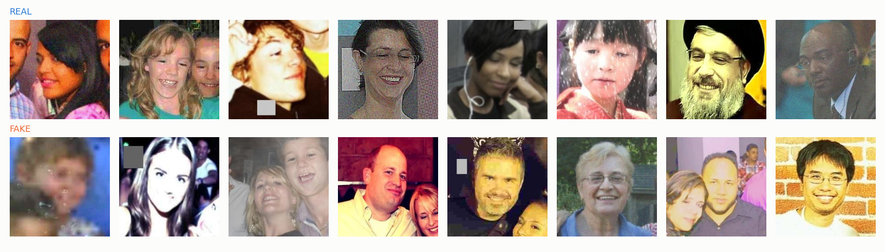
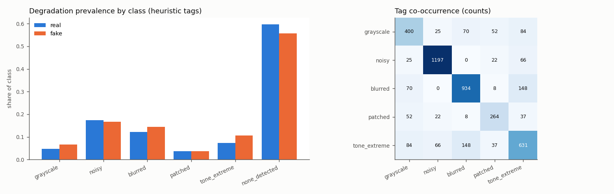
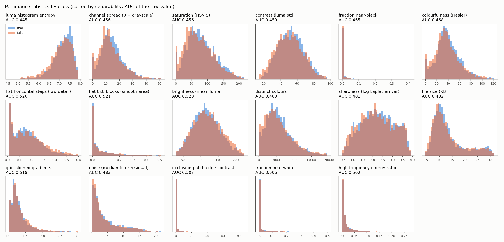
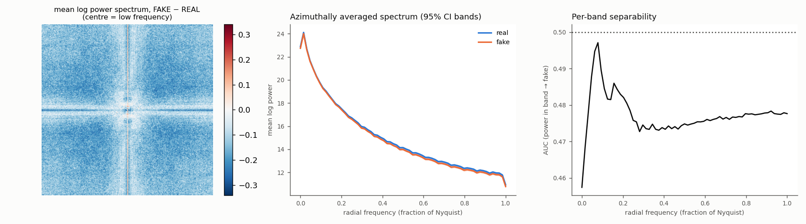
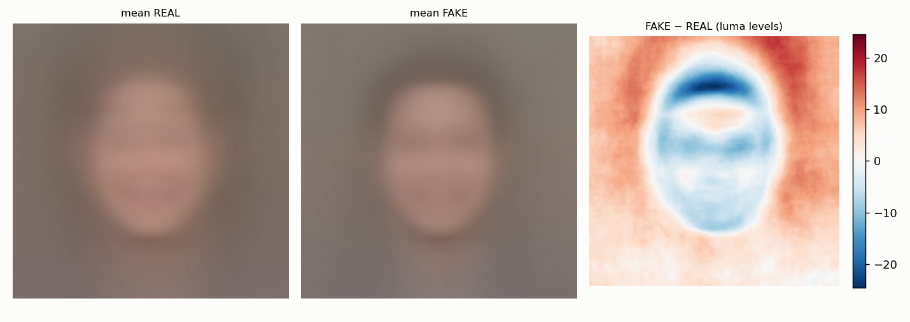
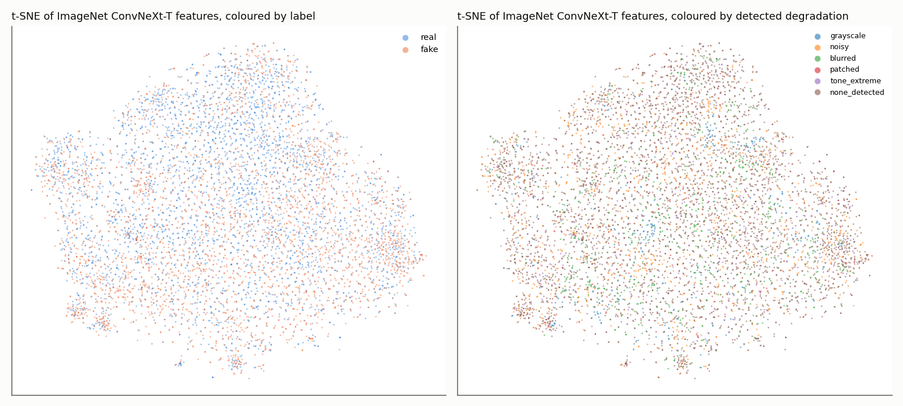
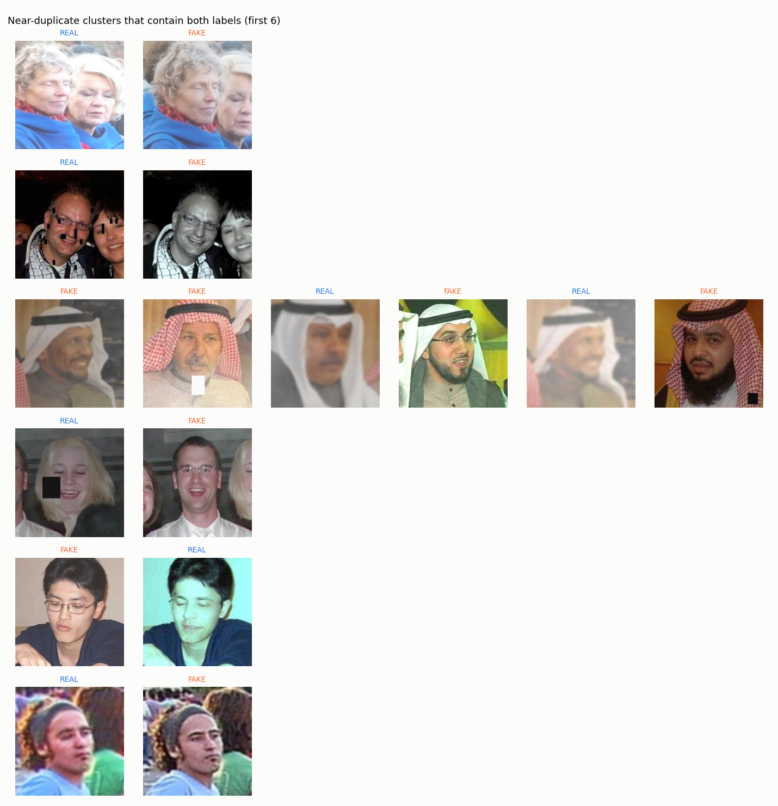
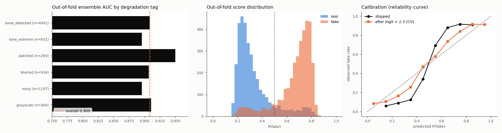
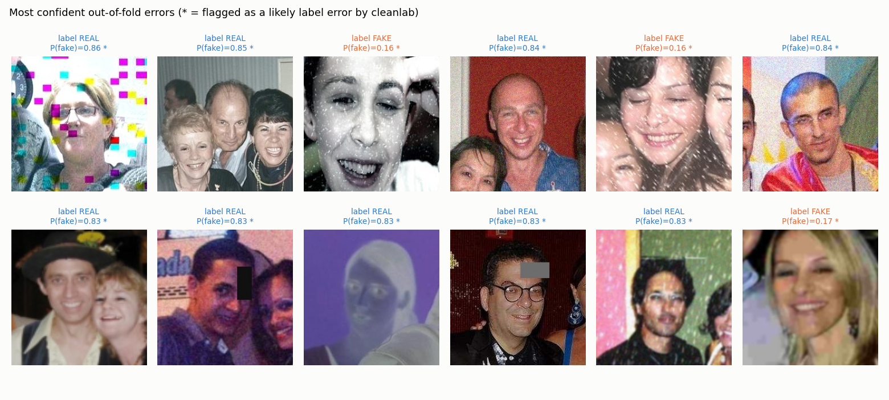

# Exploratory Data Analysis

Training data only: 7,000 labelled images. The test set was never opened for analysis.
Every number below is produced by [`scripts/eda_features.py`](../scripts/eda_features.py),
[`scripts/eda_extra.py`](../scripts/eda_extra.py) and [`scripts/eda.py`](../scripts/eda.py), and stored in
`experiments/eda/eda_numbers.json`.

## Key findings

1. **The data is clean at the file level.** All 7,000 files are 224×224 RGB JPEGs with the same quantisation table,
   no EXIF and no progressive encoding, so file format cannot leak the label. Classes are balanced (3,478 real,
   3,522 fake). Because the source resolution is already 224, training at a higher input resolution would add no
   detail.
2. **Synthetic degradations are applied to both classes almost equally.** About 42% of images carry at least one
   detectable degradation: noise, blur, grayscale, tone or solarisation, or occlusion patches. Their prevalence
   differs only slightly between classes. Grayscale and extreme-tone images lean fake (fake rate 0.59), which is a
   weak cue at best.
3. **Global image statistics carry almost no signal.** No single statistic out of 17 reaches more than 0.555
   separability. A grouped-CV logistic regression on all of them gets **AUC 0.570**, and one on the full radial
   power spectrum gets **0.559**. The well-known "GAN frequency fingerprint" is absent here, probably because the
   JPEG re-encoding and degradations wipe it out.
4. **The usable signal is spatial and centred on the face.** The class-mean difference image shows a sharply
   bounded oval: fakes are darker inside the face region, brighter around it, and have a dark band at the
   hairline. This is the footprint of a face-swap blending mask, and it is where the 0.707 AUC of the pixel
   baseline comes from.
5. **Near-duplicates are real and would leak across a random split.** 909 images (13%) sit in 424 multi-image
   clusters. In 101 of those clusters both labels appear, and inspection shows these are real/fake pairs of the
   same scene, i.e. the source photo and its face-swapped version. Grouped folds are therefore required.
6. **About 10% of labels look wrong.** Confident learning flags 677 images (330 real, 347 fake), spread evenly
   across degradation types. All 12 of the model's most confident out-of-fold errors are among them.
7. **The shipped model is accurate but under-confident.** The out-of-fold AUC is 0.909, but its probabilities
   only span 0.15–0.85 (expected calibration error 0.167). Multiplying the logit by about 2.3, fitted with
   cross-validation, cuts the calibration error to **0.041** and log-loss from 0.442 to **0.363**, with no change
   to any label or to AUC.

---

## 1. Integrity and balance

| Check | Result |
|---|---|
| Rows in `train_metadata.csv` / unique IDs / files on disk | 7,000 / 7,000 / 7,000 |
| Real / fake | 3,478 / 3,522 (50.3% fake) |
| Size, mode, format | all 224×224, RGB, JPEG |
| JPEG quantisation table | one table for every file (DC step 3, roughly quality 90+) |
| EXIF / progressive JPEG | none / none |
| File size, median real vs fake | 11.5 KB vs 11.3 KB (AUC 0.48) |

Folds (5-fold `StratifiedGroupKFold` on near-duplicate clusters, seed 42):

| Fold | 0 | 1 | 2 | 3 | 4 |
|---|---|---|---|---|---|
| Images | 1,387 | 1,426 | 1,399 | 1,402 | 1,386 |
| Fake rate | 0.514 | 0.493 | 0.512 | 0.501 | 0.496 |

<p align="center"><br>
<em>Random real (top) and fake (bottom) training images.</em></p>

## 2. Degradations

The images were degraded synthetically before release. I tagged each image with simple detectors, then checked
the thresholds by eye on sample grids (`figures/eda/tag_*.png`):

| Tag | Rule | Images | Share of real | Share of fake | Fake rate |
|---|---|---|---|---|---|
| noisy | median-filter residual std > 9 | 1,197 | 17.5% | 16.8% | 0.49 |
| blurred | log₁₀ Laplacian variance < 1.2 | 934 | 12.2% | 14.5% | 0.55 |
| tone_extreme | > 25% clipped pixels, or luma std < 25 | 631 | 7.4% | 10.6% | 0.59 |
| grayscale | mean channel spread < 2.5 | 400 | 4.8% | 6.6% | 0.59 |
| patched | uniform rectangle with edge contrast ≥ 15 | 264 | 3.8% | 3.8% | 0.50 |
| none detected | — | 4,041 | 59.7% | 55.8% | 0.49 |

Most degraded images carry one tag (2,536), 380 carry two, and 43 carry three or four.

**Detector limits:**
- **Patches:** the rule is precise but misses fainter patches. About 6 in 10 images with edge contrast 8–15 also
  have a patch, so the true patch rate is higher.
- **Pixelation:** I did not tag it. Two detectors (flat horizontal steps, grid-aligned gradients) mostly fired on
  smooth backgrounds and patch edges, so neither passed the eye check.

<p align="center"><br>
<em>Tag prevalence by class, and how often tags co-occur. Noise and blur never co-occur.</em></p>

## 3. Global statistics do not separate the classes

<p align="center"><br>
<em>Distribution of 17 per-image statistics, real vs fake, with the AUC of each raw value.</em></p>

| Statistic | AUC | Median real | Median fake |
|---|---|---|---|
| luma histogram entropy | 0.445 | 7.23 | 7.14 |
| channel spread (colour) | 0.456 | 13.8 | 12.4 |
| saturation | 0.456 | 76.1 | 68.8 |
| contrast | 0.459 | 52.4 | 50.0 |
| brightness | 0.520 | 115.1 | 118.2 |
| sharpness | 0.481 | 2.25 | 2.17 |
| noise | 0.483 | 2.98 | 2.71 |
| high-frequency energy ratio | 0.502 | 0.008 | 0.007 |
| **logistic regression on all 17 (grouped CV)** | **0.570** | | |

Fakes are slightly less colourful and slightly lower in contrast and entropy, which fits a blended face region
that is smoother than its surroundings. Every effect is small, though, and the distributions overlap almost
completely.

## 4. Frequency domain

<p align="center"><br>
<em>Left: mean log power spectrum, fake minus real. Middle: azimuthal average with 95% CI bands. Right: AUC of
each radial band.</em></p>

Fakes have slightly *less* power at all frequencies, by about 0.1–0.3 log units. Every band sits between AUC
0.46 and 0.50, and a logistic regression on the full 65-band profile reaches only 0.559. There is no
high-frequency peak or periodic upsampling artefact in this data. A frequency-based branch would therefore add
little, unless it works on local patches rather than the whole image.

## 5. Where the signal is: the face region

<p align="center"><br>
<em>Mean real image, mean fake image, and their difference in luma levels (up to ±25).</em></p>

The difference is organised in space, not texture. It is a sharp oval matching the face, darker in fakes, with a
brighter surround and a dark band at the hairline. This is consistent with the blending mask of a face-swap
pipeline. A logistic regression on 32×32 pixels picks up this cue and reaches 0.707 AUC (Day 1 baseline). The
fine-tuned models reach 0.909, so they learn much more than this layout. On Day 2,
`scripts/shortcut_check.py` showed that even the frozen ViT probe keeps AUC 0.826 *within* quintiles of the
layout-cue score (0.857 overall), so most of its signal is not this cue.

<p align="center"><br>
<em>t-SNE of frozen ImageNet ConvNeXt-T features. Real and fake are interleaved, and degradations do not form
clusters: generic features see "a face photo", not "a manipulated face". This is why fine-tuning beat frozen
probes (0.86 → 0.90).</em></p>

## 6. Near-duplicates and leakage

Images are linked into clusters when they are the same scene, using thumbnail correlation, perceptual hashing
and embedding similarity.

| | Count |
|---|---|
| Clusters | 6,515 |
| Singletons | 6,091 |
| Multi-image clusters (sizes 2–11) | 424, holding 909 images |
| Clusters containing both labels | 101, holding 247 images |

<p align="center"><br>
<em>Clusters containing both labels. Most are a source photo and its face-swapped version, sometimes with
different degradations.</em></p>

The mixed pairs are a strong reason to use grouped splits. With a random split, the model could memorise a
scene from its real copy and recognise the fake by the difference, which would inflate validation AUC. The
third row also shows a weakness of the clustering: one 6-image cluster joins different men with similar
headwear, so embedding similarity sometimes over-merges. Over-merging only makes the split more conservative.

## 7. Label noise

Confident learning (cleanlab) on out-of-fold predictions flags **677 images (9.7%)**: 330 labelled real and 347
labelled fake. The flag rate is flat across degradation tags (8.3–10.7%), so the noise is not concentrated in
heavily degraded images. The model agrees with the given label on 96.2% of unflagged images but only 5.5% of
flagged ones. That gap is partly circular, since the flags come from out-of-fold predictions, but visual
inspection of the flagged pairs (`figures/label_issues_given_*.png`) supports the flags. Removing the flagged
images from training improved worst-case robustness AUC for both backbones (Day 5).

## 8. Where the shipped model fails

The ensemble's out-of-fold predictions use the same members, weights and standardisation as the submitted
model.

<p align="center"><br>
<em>AUC by degradation tag; score distributions; reliability curve before and after logit scaling.</em></p>

| Slice | n | AUC | Accuracy |
|---|---|---|---|
| all | 7,000 | 0.909 | 0.874 |
| patched | 264 | 0.950 | 0.898 |
| grayscale | 400 | 0.911 | 0.878 |
| none detected | 4,041 | 0.908 | 0.874 |
| blurred | 934 | 0.907 | 0.863 |
| noisy | 1,197 | 0.896 | 0.869 |
| tone_extreme | 631 | 0.896 | 0.872 |

Per-slice AUCs are within about ±0.015 of the overall figure. With n of a few hundred, the uncertainty is about
±0.03, so only "noise and extreme tone are slightly harder" is a safe reading. By quintiles of brightness,
contrast, sharpness and noise, AUC stays between 0.894 and 0.923. Both extremes of sharpness and noise are a
little harder than the middle.

**Calibration:**

| | Expected calibration error | Log-loss |
|---|---|---|
| shipped | 0.167 | 0.442 |
| logit × 2.3 (fitted on 4 folds, applied to the 5th) | **0.041** | **0.363** |

The scale factor is stable across folds (2.25–2.30). It changes no label and no AUC, because it is monotonic and
maps 0.5 to 0.5. It only makes the confidence column honest.

<p align="center"><br>
<em>The 12 most confident out-of-fold errors. All 12 were flagged by cleanlab as likely label errors.</em></p>

## 9. What this means for modelling

| Finding | Consequence |
|---|---|
| Format, size and JPEG settings identical across classes | No metadata shortcut; nothing to normalise; native resolution is 224 |
| Degradations are near-balanced across classes | They are noise to be robust to, not a cue; hence degradation augmentation |
| Global and spectral statistics ≈ chance | Hand-crafted or frequency features are not worth an ensemble slot |
| Signal sits in the face region | Spatial models (ViT, ConvNeXt) with full fine-tuning |
| Same-scene real/fake pairs | Grouped folds on near-duplicate clusters (required for honest validation) |
| ~10% noisy labels | Prune flagged images from training; measured AUC is capped near 0.91 |
| Under-confident probabilities | Scale the ensemble logit by ~2.3 at inference (labels unchanged) |

## Reproduce

```bash
python scripts/eda_features.py   # per-image statistics -> experiments/eda/image_stats.csv (~10 min)
python scripts/eda_extra.py      # blockiness and occlusion-patch detectors (~5 min)
python scripts/eda.py            # figures -> reports/figures/eda/, numbers -> experiments/eda/eda_numbers.json
```
